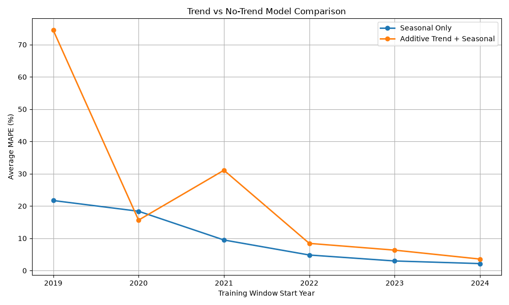
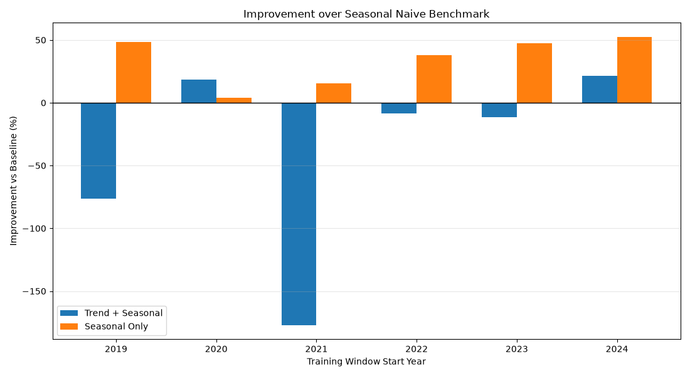
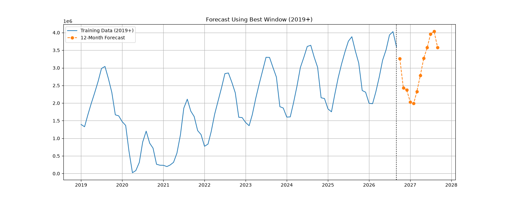
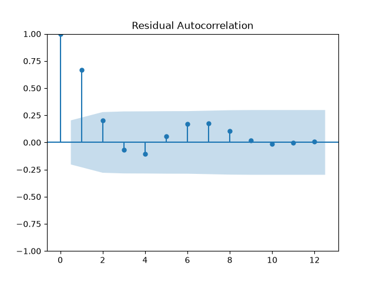
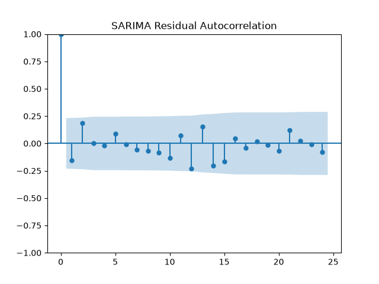
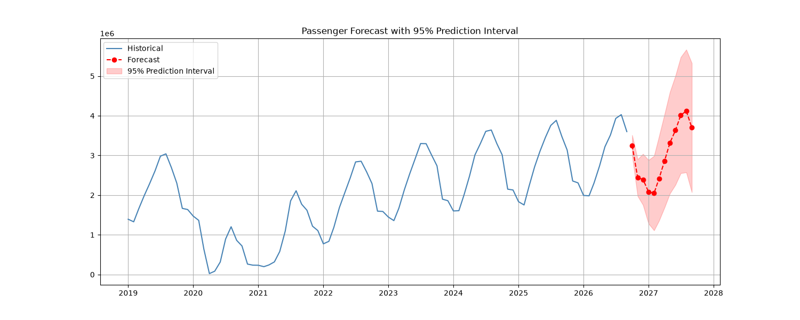

# Passenger Traffic Forecasting for Athens International Airport

## Contents

- [Project Summary](#project-summary)
- [Exploratory Analysis](#exploratory-analysis)
- [Establishing a Baseline Forecast](#establishing-a-baseline-forecast)

- [Holt-Winters Model](#holt-winters-model)
  - [Initial Model Specification](#initial-model-specification)
  - [Validation Framework](#validation-framework)
  - [Trend Component Evaluation](#trend-component-evaluation)
  - [Evaluating Improvement Against the Baseline](#evaluating-improvement-against-the-baseline)
  - [HW Model Diagnostics](#hw-model-diagnostics)
  - [Final Holt-Winters Forecast](#final-holt-winters-forecast)
  - [Why SARIMA Was Considered](#why-sarima-was-considered)

- [SARIMA Model](#sarima-model)
  - [SARIMA Identification](#sarima-identification)
  - [Train-Test Validation](#train-test-validation)
  - [Candidate Model Selection](#candidate-model-selection)
  - [Model Comparison](#model-comparison)
  - [Model Interpretation](#model-interpretation)
  - [Residual Diagnostics](#residual-diagnostics)
  - [Why SARIMA Improved on Holt-Winters](#why-sarima-improved-on-holt-winters)
  - [Final SARIMA Forecast](#final-sarima-forecast)

- [Key Conclusions](#key-conclusions)

## Project Summary

| Item | Value |
|--------|--------|
| Forecast Horizon | Oct 2026 - Sep 2027 |
| Dataset | Monthly Passenger Traffic (Jan 2019- Sep 2026) |
| Airport | Athens International Airport (AIA) |
| Models Evaluated | Holt-Winters, SARIMA |
| Benchmark | Seasonal Naive |
| Final Holt-Winters Specification | Multiplicative Seasonality, No Trend |
| Final SARIMA Specification | SARIMA(1,1,0)(1,1,0,12) |
| Forecast Training Data | Jan 2019 - Sep 2026 |

    
In this project, we forecast passenger traffic at Athens International Airport using monthly data from 2019 onwards. Two forecasting methods are evaluated: **Holt-Winters Exponential Smoothing** and **Seasonal ARIMA (SARIMA)**.

The forecasting horizon covers the period from October 2026 through September 2027. 

## Exploratory Analysis
We begin by visualizing the available monthly passenger traffic data. 

#### <h3 align="center">Historical AIA Passenger Traffic</h3>

  

Several key patterns emerge like strong seasonality, passenger traffic follows an overall upward trend, Demand is lower during the winter months and peaks during the summer tourist season.
These observations are consistent with the seasonality expected from the tourism-driven market of Greece.

## Establishing a Baseline Forecast
Before developing our forecasting models, we create a simple baseline forecast. The baseline assumes that passenger traffic in each month will be equal to the traffic observed in the same month of the previous year.

The purpose of this benchmark is to decide whether more advanced forecasting methods provide additional predictive value.

To evaluate performance, baseline forecasts are compared with actual passenger traffic over the test periods. Forecast accuracy is measured using the Mean Absolute Percentage Error (MAPE). This baseline MAPE serves as the benchmark against which all subsequent models are evaluated.

# Holt-Winters Model
## Initial Model Specification
The first forecasting model evaluated is Holt-Winters Exponential Smoothing with a multiplicative seasonal structure and an additive trend component.

## Validation Framework
To ensure robust model selection, forecasting performance was tested across multiple historical periods rather than relying on a single train-test split. Results were benchmarked against a simple year-over-year forecasting approach, and the final specification was chosen based on both forecast accuracy and its ability to provide additional predictive value beyond the baseline forecast.

## Trend Component Evaluation
Following the strong recovery in passenger traffic after COVID-19, it seemed reasonable to include a trend component in the Holt-Winters model. Passenger volumes had increased significantly between 2021 and 2026, suggesting that this growth might continue during the forecast period.
To test this assumption, the Holt-Winters framework was evaluated using two alternative specifications:

1.	Trend + Multiplicative Seasonality
2.	Multiplicative Seasonality only

Both models were assessed using the same rolling-origin validation framework described previously and were compared against the Seasonal Naive benchmark.

The expectation was that the trend model would produce more accurate forecasts by capturing the airport's long-term growth. 

Surprisingly, the results showed the opposite.

In most cases, adding a trend component resulted in higher forecasting errors. 

  

## Evaluating Improvement Against the Baseline
After comparing the two Holt-Winters specifications, the next step is to evaluate whether they provide any improvement over the Seasonal Naive benchmark.

In several validation periods, the trend model produced less accurate forecasts than the Seasonal Naive benchmark.

By contrast, the seasonality-only model consistently outperformed the benchmark across all training windows.

  

For this reason, the trend component was removed from the final specification. 

The results showed that, for a 12-month forecasting horizon, passenger traffic at Athens International Airport is better explained by strong seasonal patterns than by extending recent growth trends into the future.

## Final Holt-Winters Forecast
The final forecasting model therefore retained a multiplicative seasonal structure without a trend component.

  

## Why SARIMA Was Considered
We observed that the final Holt-Winters model delivered stable forecasts and consistently outperformed the Seasonal Naive benchmark. However, residual diagnostics revealed autocorrelation in the forecast errors. The residual ACF plot showed a strong positive correlation at lag 1, while the Ljung-Box test indicated statistically significant residual autocorrelation (p < 0.05).

### Holt-Winters residual ACF plot

  

These findings indicate that the residuals were not completely random and still contained autocorrelation. In other words, some information remained unexplained by the Holt-Winters model.

This provided our motivation to evaluate SARIMA. Unlike Holt-Winters, SARIMA explicitly models autocorrelation in the time series by incorporating relationships between current and past observations. As a result, it may be able to capture patterns that remained unexplained by the Holt-Winters model and improve forecasting accuracy.

# SARIMA Model
## SARIMA Identification

Historical passenger traffic data were analysed to identify the key patterns driving demand. The results confirmed strong seasonal behaviour together with meaningful relationships between current and past passenger volumes. These insights were used to define and evaluate several SARIMA forecasting models, with the final specification selected based on forecasting accuracy.

---

## Train-Test Validation

To ensure consistency with the Holt-Winters evaluation, the same train-test split was used

---

## Candidate Model Selection

### Understanding SARIMA Parameters

SARIMA combines several components that capture different characteristics of a time series.

The notation is: **SARIMA (p,d,q) (P,D,Q,12)**

Several candidate SARIMA models were therefore evaluated:

Most candidate specifications focused on autoregressive terms because the PACF suggested that previous passenger volumes contain useful predictive information. Candidate models incorporating moving-average terms were also evaluated to determine whether modelling past forecast errors could further improve forecast accuracy.

The final model was selected based on out-of-sample forecasting accuracy using the 2025 test period.

---

## Model Comparison

| Model | Test MAPE |
|---------|---------|
| **SARIMA(1,1,0)(1,1,0,12)** | **3.40%** |
| SARIMA(1,1,0)(1,0,0,12) | 5.32% |
| SARIMA(1,1,1)(1,0,1,12) | 5.38% |
| SARIMA(0,1,1)(0,0,1,12) | 15.64% |

The best-performing specification was:

**SARIMA (1,1,0) (1,1,0,12)**

This model achieved the lowest forecasting error among all candidate specifications, with a Mean Absolute Percentage Error (MAPE) of 3.40% on the 2025 test period. As a result, it was selected as the final SARIMA model.

---

## Model Interpretation

The selected model contains:

- AR(1): One non-seasonal autoregressive term, meaning that passenger traffic is influenced by the previous month's passenger volume.
- d = 1: First-order differencing removes longer-term non-stationarity by modelling month-to-month changes.
- SAR(1): One seasonal autoregressive term, meaning that passenger traffic is influenced by passenger volumes observed during the same month one year earlier.
- D = 1: Seasonal differencing removes recurring annual patterns by modelling year-over-year changes.

In practical terms, the model assumes that passenger traffic depends both on recent monthly activity and on seasonal patterns observed during the same period in previous years.

---

## Residual Diagnostics

After fitting the selected SARIMA model, residual behaviour was examined.

The residual autocorrelation plot showed no statistically significant spikes outside the confidence intervals.

  

Unlike the Holt-Winters model, where autocorrelation remained visible in the residuals, the SARIMA residuals showed no meaningful patterns.

This indicates that the model successfully captured the remaining temporal structure present in the passenger series.

The Ljung-Box test confirmed this result. Because the p-value is substantially greater than 0.05, there is no statistical evidence of significant residual autocorrelation.

This result supports the visual evidence from the residual ACF plot and suggests that the model successfully captured the remaining temporal structure in the series.

As a result, the residuals behave largely as random noise, indicating that most of the information in the data has been captured by the model.

---

## Why SARIMA Improved on Holt-Winters

The Holt-Winters model focuses primarily on estimating level, trend and seasonal patterns.

SARIMA goes one step further by explicitly modelling autocorrelation, meaning that it captures how current passenger volumes depend on previous observations.

While passenger traffic itself showed significant autocorrelation, the important question is whether that autocorrelation remains after fitting a forecasting model.

For Holt-Winters, residual diagnostics indicated that some autocorrelation remained unexplained. For SARIMA, the residual autocorrelation largely disappeared.

This suggests that SARIMA was able to capture patterns that Holt-Winters left unmodelled, resulting in more accurate forecasts.

### Forecast Accuracy Comparison (2025 Test Period)

| Model | MAPE |
|---------|---------:|
| Seasonal Naive | 6.84% |
| Holt-Winters | 4.96% |
| SARIMA(1,1,0)(1,1,0,12) | 3.40% |

SARIMA achieved the lowest forecasting error on the 2025 test period, reducing MAPE by approximately 31% relative to Holt-Winters and by 50% relative to the Seasonal Naive benchmark.

The combination of lower forecasting error and the absence of significant residual autocorrelation indicates that SARIMA was better able to explain the historical passenger traffic patterns, resulting in more accurate forecasts.

---

## Final SARIMA Forecast

The final SARIMA(1,1,0)(1,1,0,12) model was fitted using all available historical observations and used to generate a 12-month forecast covering October 2026 through September 2027.

  

### 12-Month SARIMA Passenger Forecast

| Month | Forecast Passengers |
|---------|------------------:|
| Oct 2026 | 3.25 M |
| Nov 2026 | 2.44 M |
| Dec 2026 | 2.39 M |
| Jan 2027 | 2.08 M |
| Feb 2027 | 2.05 M |
| Mar 2027 | 2.42 M |
| Apr 2027 | 2.86 M |
| May 2027 | 3.32 M |
| Jun 2027 | 3.63 M |
| Jul 2027 | 4.01 M |
| Aug 2027 | 4.12 M |
| Sep 2027 | 3.70 M |

As with all statistical forecasting models, unexpected external events such as the COVID-19 pandemic cannot be predicted. Because the historical data include this highly volatile period, the resulting confidence intervals are unusually wide. As a result, the analysis focuses primarily on point forecasts while acknowledging the uncertainty associated with future passenger demand.

The resulting forecast reflects a transition from the rapid post-COVID recovery period towards a more stable growth trajectory while preserving the well-established seasonal behaviour of Athens International Airport passenger traffic.

Passenger volumes are expected to increase by approximately 2% to 5% year-over-year across most forecast months, with August 2027 projected to exceed 4.1 million passengers.

From a modelling perspective, the absence of significant residual autocorrelation suggests that the final SARIMA specification successfully captured the main predictable patterns present in the historical passenger series.

### Forecast Comparison (Oct 2026 - Sep 2027)

| Month | SARIMA Forecast | Holt-Winters Forecast |
|---------|---------------:|---------------------:|
| Oct 2026 | 3,253,803 | 3,261,800 |
| Nov 2026 | 2,438,702 | 2,430,990 |
| Dec 2026 | 2,394,066 | 2,372,065 |
| Jan 2027 | 2,082,173 | 2,034,746 |
| Feb 2027 | 2,048,996 | 1,987,963 |
| Mar 2027 | 2,417,049 | 2,328,518 |
| Apr 2027 | 2,864,255 | 2,787,266 |
| May 2027 | 3,317,210 | 3,267,870 |
| Jun 2027 | 3,631,584 | 3,575,043 |
| Jul 2027 | 4,014,003 | 3,964,339 |
| Aug 2027 | 4,119,251 | 4,037,069 |
| Sep 2027 | 3,698,420 | 3,581,466 |

Although both models produce very similar forecasts, SARIMA consistently projected slightly higher passenger volumes and achieved superior out-of-sample forecasting accuracy during model validation (MAPE: 3.40% vs 4.96%).

For this reason, the SARIMA forecasts were retained as the final forecast for the October 2026 to September 2027 horizon.

Future actual passenger traffic data will provide an opportunity to evaluate how well these forecasts perform in practice and to compare forecasted values against realised airport demand.

## Key Conclusions

- Strong seasonality is the dominant characteristic of passenger traffic.
- Including a trend component reduced forecasting performance in most validation windows.
- The seasonality-only Holt-Winters model consistently outperformed the Seasonal Naive benchmark.
- Residual diagnostics revealed unexplained autocorrelation in the Holt-Winters forecast errors, suggesting that some temporal dependencies remained unmodelled.
- SARIMA(1,1,0)(1,1,0,12) achieved the lowest forecasting error, with a MAPE of 3.40% on the 2025 test period.
- Residual diagnostics indicated that the final SARIMA model successfully captured the remaining predictable structure in the series.
- Forecasts suggest continued passenger growth through September 2027 while preserving the strong seasonal patterns historically observed at Athens International Airport.
