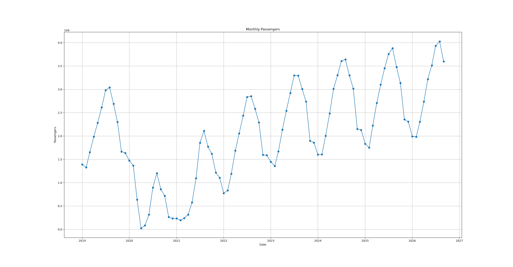

# Athens International Airport Passenger Traffic Forecasting

## Executive Summary

### Project Summary

| Item | Value |
|--------|--------|
| Forecast Horizon | Oct 2026 - Sep 2027 |
| Dataset | Monthly Passenger Traffic (Jan 2019- Sep 2026) |
| Airport | Athens International Airport (AIA) |
| Models Evaluated | Holt-Winters, SARIMA |
| Benchmark | Seasonal Naive |
| Final Holt-Winters Specification | Multiplicative Seasonality, No Trend |
| Final SARIMA Specification | SARIMA(1,1,0)(1,1,0,12) |
| Forecast Training Data | Jan 2019 - Sep 2026 |

## Objective

The objective of this project is to forecast monthly passenger traffic at Athens International Airport (AIA) for the period October 2026 to September 2027, using historical monthly data from January 2019 to September 2026.

Passenger traffic forecasts support airport capacity planning, resource allocation, staffing decisions and operational planning.

## Exploratory Analysis
We begin by visualizing the available monthly passenger traffic data. 

#### <h3 align="center">Historical AIA Passenger Traffic</h3>

  

Several key patterns emerge from the data:
- Strong seasonality is present throughout the series.
- Passenger traffic follows an overall upward trend.
- Demand is lower during the winter months and peaks during the summer tourist season.

These observations are consistent with the seasonality expected from the tourism-driven market of Greece.

## Analytical Approach

Two time-series forecasting methods were evaluated: Holt-Winters Exponential Smoothing and Seasonal ARIMA (SARIMA). Their performance was compared against a Seasonal Naive benchmark, which uses passenger traffic from the corresponding month of the previous year.

For the Holt-Winters model, multiple historical training windows were evaluated to determine the most reliable forecasting period. Using all available data from 2019 onwards provided the strongest overall performance and was therefore selected for the final model development.

The same training period was subsequently used for SARIMA, allowing a direct comparison between the two forecasting approaches.

Forecasting accuracy was assessed using Mean Absolute Percentage Error (MAPE), with model selection based on both forecast accuracy and improvement relative to the benchmark.

## Final Holt-Winters Forecast
The final forecasting model therefore retained a multiplicative seasonal structure without a trend component.

  

## Why SARIMA Was Considered

Although the final Holt-Winters model outperformed the Seasonal Naive benchmark, residual diagnostics indicated that some autocorrelation remained unexplained. This suggested that additional predictive information was still present in the data.

To address this limitation, several SARIMA specifications were evaluated, as SARIMA is specifically designed to model relationships between current and past observations.

---

### Model Comparison

| Model | MAPE |
|---------|---------:|
| Seasonal Naive | 6.84% |
| Holt-Winters | 4.96% |
| SARIMA(1,1,0)(1,1,0,12) | 3.40% |

SARIMA achieved the lowest forecasting error on the 2025 test period, reducing MAPE by approximately 31% relative to Holt-Winters and by 50% relative to the Seasonal Naive benchmark.

The combination of lower forecasting error and the absence of significant residual autocorrelation indicates that SARIMA was better able to explain the historical passenger traffic patterns, resulting in more accurate forecasts.

---

## Final SARIMA Forecast

The selected SARIMA(1,1,0)(1,1,0,12) model was fitted using all available historical data to generate the final 12-month forecast.

  

Passenger traffic is expected to retain its strong seasonal pattern, with volumes peaking during the summer of 2027. August 2027 is forecast to exceed 4.1 million passengers, while year-over-year growth is estimated at approximately 2%–5% across most forecast months.

### Forecast Comparison: SARIMA vs Holt-Winters

| Month | SARIMA Forecast | Holt-Winters Forecast |
|---------|---------------:|---------------------:|
| Oct 2026 | 3,253,803 | 3,261,800 |
| Nov 2026 | 2,438,702 | 2,430,990 |
| Dec 2026 | 2,394,066 | 2,372,065 |
| Jan 2027 | 2,082,173 | 2,034,746 |
| Feb 2027 | 2,048,996 | 1,987,963 |
| Mar 2027 | 2,417,049 | 2,328,518 |
| Apr 2027 | 2,864,255 | 2,787,266 |
| May 2027 | 3,317,210 | 3,267,870 |
| Jun 2027 | 3,631,584 | 3,575,043 |
| Jul 2027 | 4,014,003 | 3,964,339 |
| Aug 2027 | 4,119,251 | 4,037,069 |
| Sep 2027 | 3,698,420 | 3,581,466 |

Although both models produce very similar forecasts, SARIMA consistently projected slightly higher passenger volumes and achieved superior out-of-sample forecasting accuracy during model validation (MAPE: 3.40% vs 4.96%).

For this reason, the SARIMA forecasts were retained as the final forecast for the October 2026 to September 2027 horizon.

Future actual passenger traffic data will provide an opportunity to evaluate how well these forecasts perform in practice and to compare forecasted values against realised airport demand.

## Key Conclusions

- Strong seasonality is the dominant characteristic of passenger traffic.
- Including a trend component reduced forecasting performance in most validation windows.
- The seasonality-only Holt-Winters model consistently outperformed the Seasonal Naive benchmark.
- Residual diagnostics revealed unexplained autocorrelation in the Holt-Winters forecast errors, suggesting that some temporal dependencies remained unmodelled.
- SARIMA(1,1,0)(1,1,0,12) achieved the lowest forecasting error, with a MAPE of 3.40% on the 2025 test period.
- Residual diagnostics indicated that the final SARIMA model successfully captured the remaining patterns present in the historical passenger traffic data.
- Forecasts suggest continued passenger growth through September 2027 while preserving the strong seasonal patterns historically observed at Athens International Airport.
