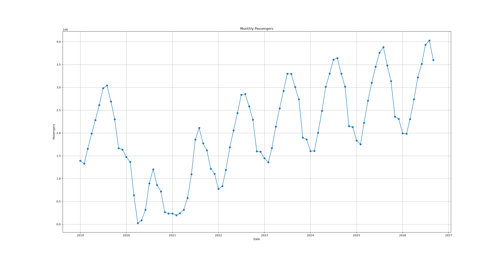
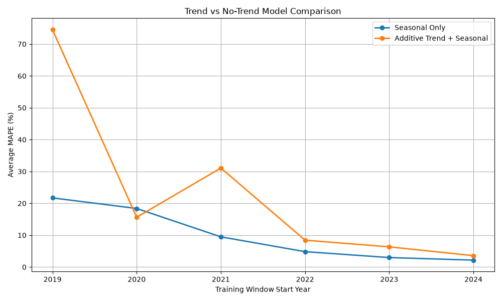
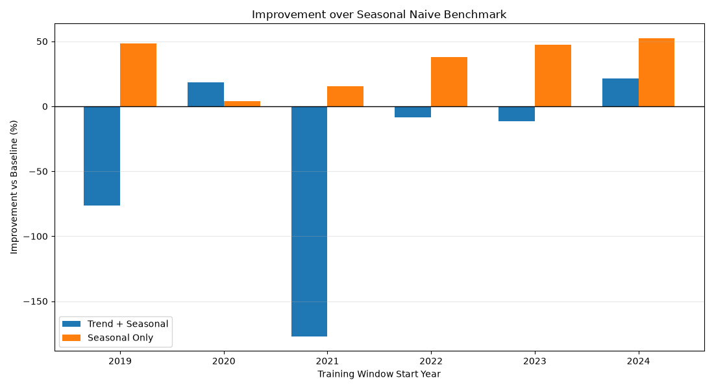
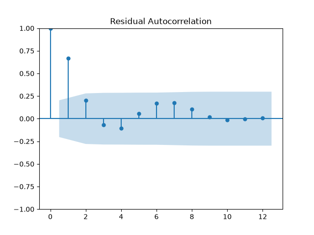

# Passenger Traffic Forecasting for Athens International Airport

## Contents

- [Project Summary](#project-summary)
- [Exploratory Analysis](#exploratory-analysis)
- [Establishing a Baseline Forecast](#establishing-a-baseline-forecast)
- [Holt-Winters Model](#holt-winters-model)
- [Model Selection and Validation Strategy](#model-selection-and-validation-strategy)
- [Trend Component Evaluation](#trend-component-evaluation)
- [Evaluating Improvement Against the Baseline](#evaluating-improvement-against-the-baseline)
- [Final Holt-Winters Model](#final-holt-winters-model)
- [Why SARIMA Was Considered](#why-sarima-was-considered)
- [SARIMA Model](#sarima-model)
- [Final Forecasts](#final-forecasts)
- [Key Conclusions](#key-conclusions)


## Project Summary

| Item | Value |
|--------|--------|
| Forecast Horizon | Oct 2026 - Sep 2027 |
| Dataset | Monthly Passenger Traffic (2019-2026) |
| Models Evaluated | Holt-Winters, SARIMA |
| Validation | Rolling-Origin Validation |
| Benchmark | Seasonal Naive |
| Final Holt-Winters Specification | Multiplicative Seasonality, No Trend |
| Selected Training Window | 2019+ |
    
In this project, we forecast passenger traffic at Athens International Airport using monthly data from 2019 onwards. Two forecasting methods are evaluated: **Holt-Winters Exponential Smoothing** and **Seasonal ARIMA (SARIMA)**.

The forecasting horizon covers the period from October 2026 through September 2027. This short forecasting window is chosen because longer-term passenger forecasts typically require additional information such as GDP growth, tourism demand, airline capacity and route development plans. For a one-year horizon, however, time series models such as Holt-Winters and SARIMA can provide reliable forecasts using only historical passenger traffic data.

As with all statistical forecasting models, unexpected external events such as the COVID-19 pandemic cannot be predicted. Because the historical data include this highly volatile period, the resulting confidence intervals are unusually wide. As a result, the analysis focuses primarily on point forecasts while acknowledging the uncertainty associated with future passenger demand.


## Exploratory Analysis
We begin by visualizing the available monthly passenger traffic data. 

### Historical AIA Passenger Traffic
<p align="center">
  
</p>

Several key patterns emerge:

- Strong seasonality is present throughout the series.
- Passenger traffic follows an overall upward trend.
- Demand is lower during the winter months and peaks during the summer tourist season.
- August is typically the busiest month of the year, while February is the weakest.

These observations are consistent with the seasonality expected from a tourism-driven market of Greece.


## Establishing a Baseline Forecast
Before developing our forecasting models, we create a simple baseline forecast. The baseline assumes that passenger traffic in each month will be equal to the traffic observed in the same month of the previous year.

The purpose of this benchmark is to decide whether more advanced forecasting methods provide additional predictive value. If a complex model cannot outperform this simple year-over-year approach, then there is no justification for using it.

To evaluate performance, baseline forecasts are compared with actual passenger traffic over the test periods. Forecast accuracy is measured using the Mean Absolute Percentage Error (MAPE). This baseline MAPE serves as the benchmark against which all subsequent models are evaluated.


## Holt-Winters Model
The first forecasting model evaluated is Holt-Winters Exponential Smoothing.

Given the characteristics of airport traffic, a multiplicative seasonal structure is initially selected. This means that seasonal fluctuations increase as passenger traffic grows. In other words, peak and low traffic periods become larger when overall passenger volumes are higher.

An additive trend component is also included to capture the long-term growth observed in the data.

The model estimates the optimal smoothing parameters (α, β, γ) and identifies the underlying level, trend, and seasonal pattern of the series based on historical passenger traffic.

Forecasts are then generated by projecting the final estimated level and trend forward while repeating the seasonal pattern observed in the most recent annual cycle. Because this approach assumes that historical seasonal behaviour remains stable, Holt-Winters is generally well suited for short- to medium-term forecasting horizons, such as the 12-month period examined here.


## Model Selection and Validation Strategy
Selecting the training period is often just as important as selecting the forecasting model itself. Rather than choosing a single training window, a rolling-origin validation framework is used to identify the period that produced the most reliable forecasts. Model performance is evaluated using Holt-Winters Exponential Smoothing and compared with a Seasonal Naive benchmark.

Instead of relying on a single train-test split, multiple out-of-sample validation sets are created. The minimum training period is set to two years, while the test period is always one year. For example, when 2019 is selected as the starting year, the following validation sets are created:

- Train: 2019-2020 → Test: 2021
- Train: 2019-2021 → Test: 2022
- Train: 2019-2022 → Test: 2023
- ...and so on until the most recent available year.

The same process is then repeated using different starting years. For example, when 2020 is selected as the starting year:

- Train: 2020-2021 → Test: 2022
- Train: 2020-2022 → Test: 2023
- Train: 2020-2023 → Test: 2024
- ...and so on.

This approach allows forecasting performance to be evaluated across different periods, including both the COVID-19 disruption and the recovery that followed.

For each validation set, monthly Absolute Percentage Errors (APE) are calculated over the test year and then averaged to produce a Mean Absolute Percentage Error (MAPE). The average MAPE across all validation sets is then calculated for each candidate starting year.

Not all starting years provide the same number of validation sets. For example, using 2024 as the starting year produces only a single train-test split (Train: 2024-2025, Test: 2026), resulting in a very limited validation sample. To ensure a more reliable comparison, only starting years with at least 3 validation sets are considered during model selection.

The primary evaluation metric is MAPE. However, comparing models using MAPE alone can be misleading because some train-test combinations are naturally more difficult than others. Events such as the COVID-19 pandemic can affect both the training and test periods, leading to unusually high forecasting errors.

To account for this, model performance is also evaluated relative to a simple Seasonal Naive benchmark. For each validation set, the Holt-Winters MAPE is compared with the corresponding baseline MAPE, where passenger traffic is assumed to be equal to the traffic observed in the same month of the previous year.

The average Baseline MAPE and average Holt-Winters MAPE are then calculated across all validation sets for each candidate starting year. Rather than selecting the model with the lowest average MAPE, the final selection criterion is the relative improvement achieved over the baseline:


```math
Improvement = \frac{Baseline\ MAPE - Model\ MAPE}{Baseline\ MAPE}
```

This approach ensures that each candidate training window is evaluated not only on forecasting accuracy but also on the additional predictive value it provides beyond a simple year-over-year forecast.

## Trend Component Evaluation
Following the strong recovery in passenger traffic after COVID-19, it seemed reasonable to include a trend component in the Holt-Winters model. Passenger volumes had increased significantly between 2021 and 2026, suggesting that this growth might continue during the forecast period.
To test this assumption, the Holt-Winters framework was evaluated using two alternative specifications:

1.	Additive Trend + Multiplicative Seasonality
2.	Multiplicative Seasonality only

Both models were assessed using the same rolling-origin validation framework described previously and were compared against the Seasonal Naive benchmark.

The expectation was that the trend model would produce more accurate forecasts by capturing the airport's long-term growth. 

Surprisingly, the results showed the opposite.

In most cases, adding a trend component resulted in higher forecasting errors. While the seasonal-only model consistently outperformed the Seasonal Naive benchmark, the trend model often produced worse results and in some cases even underperformed the benchmark itself.


| Start Year | Baseline MAPE | Trend + Seasonal | Seasonal Only |
|------------|-------------:|-----------------:|--------------:|
| 2019+ | 42.27% | 74.50% | 21.71% |
| 2020+ | 19.14% | 15.64% | 18.39% |
| 2021+ | 11.23% | 31.09% | 9.48% |
| 2022+ | 7.78% | 8.43% | 4.83% |
| 2023+ | 5.69% | 6.34% | 2.98% |
| 2024+ | 4.55% | 3.57% | 2.17% |

The results indicate that the benefit of including a trend component is inconsistent. Although the trend model performed slightly better for the 2020+ training window (15.64% vs 18.39%), it produced substantially higher errors for most of the remaining candidate windows. The most extreme example was the 2019+ window, where forecast error increased from 21.71% to 74.50% after adding a trend component. 

<p align="center">
  
</p>

## Evaluating Improvement Against the Baseline
After comparing the two Holt-Winters specifications, the next step is to evaluate whether they provide any improvement over the Seasonal Naive benchmark.

The trend model delivered inconsistent results. In most cases, it failed to outperform the Seasonal Naive benchmark and sometimes produced less accurate forecasts than simply using last year's passenger traffic. 

By contrast, the seasonality-only model consistently outperformed the benchmark across all training windows.

### Improvement vs Baseline
| Start Year | Trend + Seasonal | Seasonal Only |
|------------|----------------:|--------------:|
| 2019+ | -76.27% | 48.63% |
| 2020+ | 18.27% | 3.91% |
| 2021+ | -176.95% | 15.53% |
| 2022+ | -8.33% | 37.90% |
| 2023+ | -11.34% | 47.56% |
| 2024+ | 21.41% | 52.26% |

<p align="center">
  
</p>


Model diagnostics provided additional insight. In several validation periods, the trend smoothing parameter (β) was close to 1, indicating that the model placed very high weight on the most recent observations when estimating future growth. As a result, the model became highly sensitive to short-term fluctuations in passenger traffic. Rather than identifying a stable underlying pattern, the trend component reacted strongly to temporary changes and introduced additional forecast uncertainty.

By contrast, the seasonality-only specification produced much more stable results. The model focused on the strongest and most reliable feature present in the data: the recurring annual seasonality of passenger traffic.

The best-performing seasonality-only model was obtained using the 2019+ training window. It achieved an average MAPE of 21.71% and improved forecasting accuracy by 48.63% compared with the Seasonal Naive benchmark across six validation periods. The 2024+ training window was not considered for model selection because only starting years with at least three validation periods were included in the evaluation.

The best result for the trend-enhanced model was obtained using the 2020+ training window, with an average MAPE of 15.64% and an improvement of 18.27% over the benchmark. Although this MAPE was lower, the model's performance was much less consistent across the different validation periods and most times failed to outperform the baseline forecast.

For this reason, the trend component was removed from the final specification. The results showed that, for a 12-month forecasting horizon, passenger traffic at Athens International Airport is better explained by strong seasonal patterns than by extending recent growth trends into the future.

## Final Holt-Winters Model
The final forecasting model therefore retained a multiplicative seasonal structure without a trend component, as this specification delivered more stable forecasts, lower validation errors, and substantially stronger improvements over the Seasonal Naive benchmark across multiple out-of-sample periods.

## Why SARIMA Was Considered
The final Holt-Winters model delivered stable forecasts and consistently outperformed the Seasonal Naive benchmark. However, further analysis suggested that some information remained unexplained.

Residual diagnostics revealed statistically significant autocorrelation in the forecast errors. The residual ACF showed a strong positive correlation at lag 1, while the Ljung-Box test rejected the assumption of independent residuals (p < 0.05).

<p align="center">
  
</p>

These findings indicate that the residuals were not completely random and still contained autocorrelation. In other words, some information remained unexplained by the Holt-Winters model.

This provided a strong motivation to evaluate SARIMA. Unlike Holt-Winters, SARIMA explicitly models autocorrelation in the time series by incorporating relationships between current and past observations. As a result, it may be able to capture patterns that remained unexplained by the Holt-Winters model and improve forecasting accuracy.

## Key Conclusions
- Strong seasonality is the dominant characteristic of passenger traffic.
- The trend component reduced forecasting performance in most validation windows.
- The seasonality-only Holt-Winters model consistently outperformed the Seasonal Naive benchmark.
- Residual diagnostics indicated remaining autocorrelation.
- These results suggest that SARIMA may further improve forecast accuracy.

