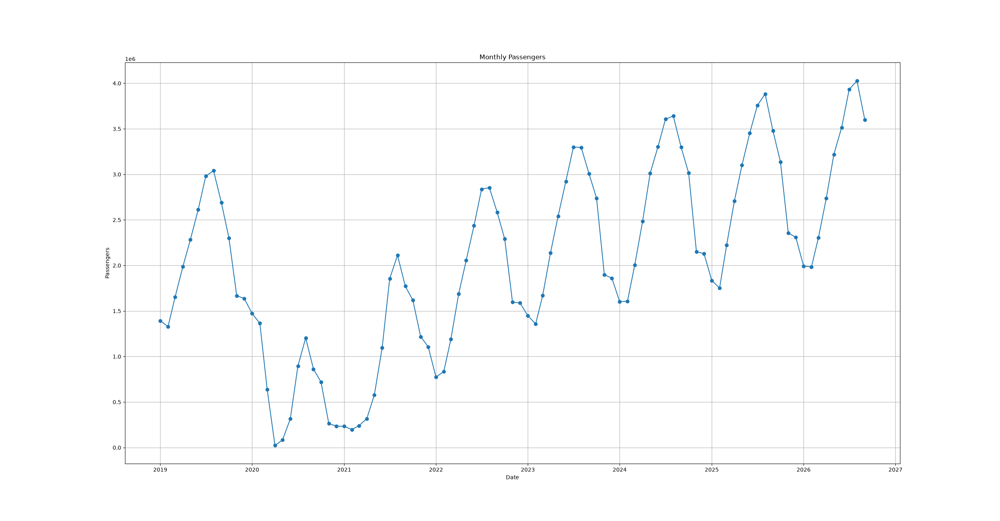
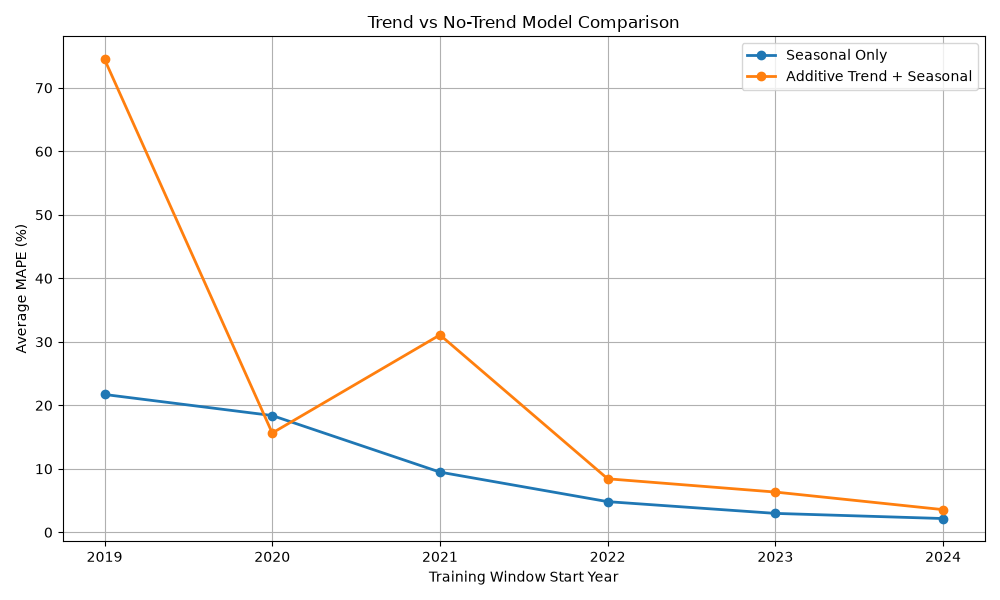
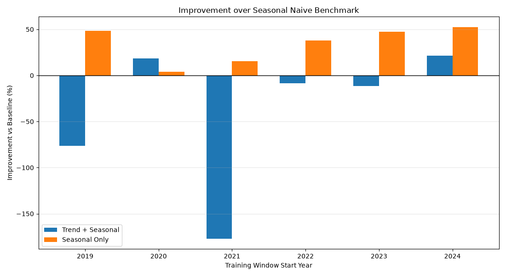
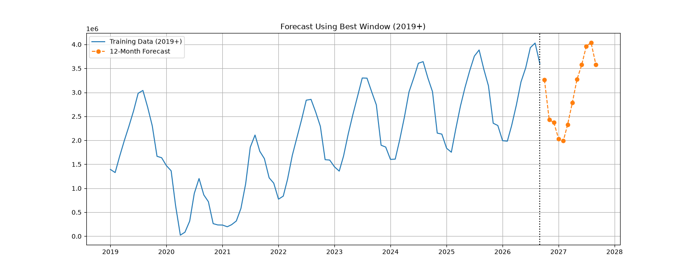
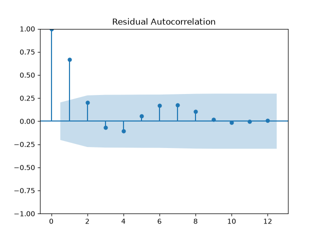
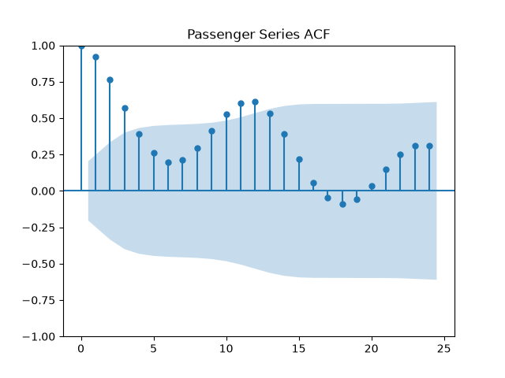
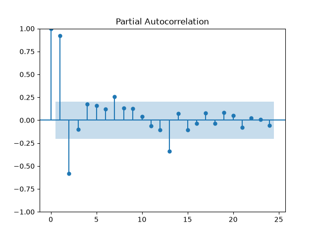
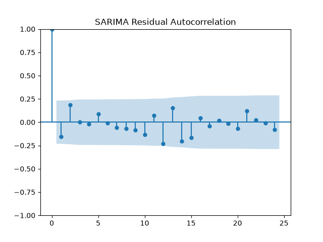
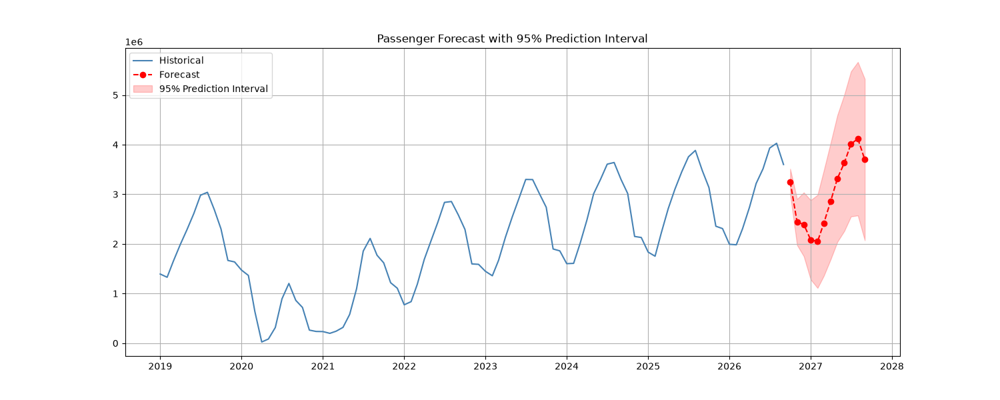

# Passenger Traffic Forecasting for Athens International Airport

## Contents

- [Project Summary](#project-summary)
- [Exploratory Analysis](#exploratory-analysis)
- [Establishing a Baseline Forecast](#establishing-a-baseline-forecast)

- [Holt-Winters Model](#holt-winters-model)
  - [Initial Model Specification](#initial-model-specification)
  - [Validation Framework](#validation-framework)
  - [Trend Component Evaluation](#trend-component-evaluation)
  - [Evaluating Improvement Against the Baseline](#evaluating-improvement-against-the-baseline)
  - [HW Model Diagnostics](#hw-model-diagnostics)
  - [Final Holt-Winters Forecast](#final-holt-winters-forecast)
  - [Why SARIMA Was Considered](#why-sarima-was-considered)

- [SARIMA Model](#sarima-model)
  - [SARIMA Identification](#sarima-identification)
  - [Train-Test Validation](#train-test-validation)
  - [Candidate Model Selection](#candidate-model-selection)
  - [Model Comparison](#model-comparison)
  - [Model Interpretation](#model-interpretation)
  - [Residual Diagnostics](#residual-diagnostics)
  - [Why SARIMA Improved on Holt-Winters](#why-sarima-improved-on-holt-winters)
  - [Final SARIMA Forecast](#final-sarima-forecast)

- [Key Conclusions](#key-conclusions)


## Project Summary

| Item | Value |
|--------|--------|
| Forecast Horizon | Oct 2026 - Sep 2027 |
| Dataset | Monthly Passenger Traffic (Jan 2019- Sep 2026) |
| Airport | Athens International Airport (AIA) |
| Models Evaluated | Holt-Winters, SARIMA |
| Benchmark | Seasonal Naive |
| Final Holt-Winters Specification | Multiplicative Seasonality, No Trend |
| Final SARIMA Specification | SARIMA(1,1,0)(1,1,0,12) |
| Forecast Training Data | Jan 2019 - Sep 2026 |

    
In this project, we forecast passenger traffic at Athens International Airport using monthly data from 2019 onwards. Two forecasting methods are evaluated: **Holt-Winters Exponential Smoothing** and **Seasonal ARIMA (SARIMA)**.

The forecasting horizon covers the period from October 2026 through September 2027. This short forecasting window is chosen because longer-term passenger forecasts typically require additional information such as GDP growth, tourism demand, airline capacity and route development plans. For a one-year horizon, however, time series models such as Holt-Winters and SARIMA can provide reliable forecasts using only historical passenger traffic data.

The historical data include an unusually volatile period covering both the COVID-19 disruption and the recovery that followed. For this reason, forecast uncertainty is higher than would typically be expected. Although the models provide a robust estimate of future passenger demand, the unusual volatility observed means that future passenger volumes may vary more widely than would normally be expected.

## Exploratory Analysis
We begin by visualizing the available monthly passenger traffic data. 

#### <h3 align="center">Historical AIA Passenger Traffic</h3>
<p align="center">
  
</p>

Several key patterns emerge:

- Strong seasonality is present throughout the series.
- Passenger traffic follows an overall upward trend.
- Demand is lower during the winter months and peaks during the summer tourist season.
- August is typically the busiest month of the year, while February is typically the month with the lowest passenger traffic.

These observations are consistent with the seasonality expected from the tourism-driven market of Greece.

## Establishing a Baseline Forecast
Before developing our forecasting models, we create a simple baseline forecast. The baseline assumes that passenger traffic in each month will be equal to the traffic observed in the same month of the previous year.

The purpose of this benchmark is to decide whether more advanced forecasting methods provide additional predictive value. If a complex model cannot outperform this simple year-over-year approach, then there is no justification for using it.

To evaluate performance, baseline forecasts are compared with actual passenger traffic over the test periods. Forecast accuracy is measured using the Mean Absolute Percentage Error (MAPE). This baseline MAPE serves as the benchmark against which all subsequent models are evaluated.


# Holt-Winters Model
## Initial Model Specification
The first forecasting model evaluated is Holt-Winters Exponential Smoothing.

The exploratory analysis revealed strong seasonality in passenger traffic, making a multiplicative seasonal structure a natural starting point for the Holt-Winters model. This means that seasonal fluctuations increase as passenger traffic grows. In other words, peak and low traffic periods become larger when overall passenger volumes are higher.

An additive trend component is also included to capture the long-term growth observed in the data.

The model estimates the optimal smoothing parameters (α, β, γ) and identifies the underlying level, trend, and seasonal pattern of the series based on historical passenger traffic.

Forecasts are then generated by projecting the final estimated level and trend forward while repeating the seasonal pattern observed in the most recent annual cycle. Because this approach assumes that historical seasonal behaviour remains stable, Holt-Winters is generally well suited for short- to medium-term forecasting horizons, such as the 12-month period examined here.


## Validation Framework
Selecting the training period is often just as important as selecting the forecasting model itself. Rather than choosing a single training window, a rolling-origin validation framework is used to identify the period that produced the most reliable forecasts. Model performance is evaluated using Holt-Winters Exponential Smoothing and then compared with the Seasonal Naive benchmark.

Instead of relying on a single train-test split, multiple out-of-sample validation sets are created. The minimum training period is set to two years, while the test period is always one year. For example, when 2019 is selected as the starting year, the following validation sets are created:

- Train: 2019-2020 → Test: 2021
- Train: 2019-2021 → Test: 2022
- Train: 2019-2022 → Test: 2023
- ...and so on until the most recent available year.

The same process is then repeated using different starting years. For example, when 2020 is selected as the starting year:

- Train: 2020-2021 → Test: 2022
- Train: 2020-2022 → Test: 2023
- Train: 2020-2023 → Test: 2024
- ...and so on.

This approach allows forecasting performance to be evaluated across different periods, including both the COVID-19 disruption and the recovery that followed.

For each validation set, monthly Absolute Percentage Errors (APE) are calculated over the test year and then averaged to produce a Mean Absolute Percentage Error (MAPE). The average MAPE across all validation sets is then calculated for each candidate starting year.

Not all starting years provide the same number of validation sets. For example, using 2024 as the starting year produces only a single train-test split (Train: 2024-2025, Test: 2026), resulting in a very limited validation sample. To ensure a more reliable comparison, only starting years with at least 3 validation sets are considered during model selection.

Forecast accuracy is evaluated using Mean Absolute Percentage Error (MAPE). However, comparing models using MAPE alone can be misleading because some validation periods are inherently more challenging to forecast than others. Extraordinary events such as the COVID-19 pandemic affected both the training and testing periods, leading to unusually high forecasting errors regardless of model specification.

To account for this, model performance is also evaluated relative to the Seasonal Naive benchmark introduced earlier. For each validation set, the Holt-Winters MAPE is compared with the corresponding Baseline MAPE.

The average Baseline MAPE and average Holt-Winters MAPE are then calculated across all validation sets for each candidate starting year. Rather than selecting the training window with the lowest average MAPE, the final selection criterion is the relative improvement achieved over the baseline:


```math
Improvement = \frac{Baseline\ MAPE - Model\ MAPE}{Baseline\ MAPE}
```

This approach ensures that each candidate training window is evaluated not only on forecasting accuracy but also on the additional predictive value it provides beyond a simple year-over-year forecast.

## Trend Component Evaluation
Following the strong recovery in passenger traffic after COVID-19, it seemed reasonable to include a trend component in the Holt-Winters model. Passenger volumes had increased significantly between 2021 and 2026, suggesting that this growth might continue during the forecast period.
To test this assumption, the Holt-Winters framework was evaluated using two alternative specifications:

1.	Holt-Winters with Additive Trend and Multiplicative Seasonality
2.	Holt-Winters with Multiplicative Seasonality Only

Both models were assessed using the same rolling-origin validation framework described previously and were compared against the baseline benchmark.

The expectation was that the trend model would produce more accurate forecasts by capturing the airport's long-term growth. 

Surprisingly, the results showed the opposite.

In most cases, adding a trend component resulted in higher forecasting errors. While the seasonal-only model consistently outperformed the Seasonal Naive benchmark, the trend model often produced worse results and in some cases even underperformed the benchmark itself.


| Start Year | Baseline MAPE | HW Trend + Seasonal MAPE | HW Seasonal Only MAPE|
|------------|-------------:|-----------------:|--------------:|
| 2019+ | 42.27% | 74.50% | 21.71% |
| 2020+ | 19.14% | 15.64% | 18.39% |
| 2021+ | 11.23% | 31.09% | 9.48% |
| 2022+ | 7.78% | 8.43% | 4.83% |
| 2023+ | 5.69% | 6.34% | 2.98% |
| 2024+ | 4.55% | 3.57% | 2.17% |

The results indicate that the benefit of including a trend component is inconsistent across validation periods. Although the trend model performed slightly better for the 2020+ training window (15.64% vs 18.39%), it produced substantially higher errors for most of the remaining candidate windows. The most extreme example was the 2019+ window, where forecast error increased from 21.71% to 74.50% after adding a trend component. 

<p align="center">
  
</p>

## Evaluating Improvement Against the Baseline
The relative improvement achieved by each Holt-Winters specification over the baseline forecast is shown below.

### Improvement vs Baseline
| Start Year | Trend + Seasonal | Seasonal Only |
|------------|----------------:|--------------:|
| 2019+ | -76.27% | 48.63% |
| 2020+ | 18.27% | 3.91% |
| 2021+ | -176.95% | 15.53% |
| 2022+ | -8.33% | 37.90% |
| 2023+ | -11.34% | 47.56% |
| 2024+ | 21.41% | 52.26% |

<p align="center">
  
</p>

## HW Model Diagnostics
Model diagnostics provided additional insight into the behaviour of the trend-enhanced specification. Although the best result for the trend-enhanced specification was obtained using the 2020+ training window, with an average MAPE of 15.64%, its performance was far less consistent across validation periods. The trend smoothing parameter (β) was frequently close to 1, causing the model to place excessive weight on the most recent observations and become highly sensitive to short-term fluctuations in passenger traffic.

The best-performing seasonality-only model was obtained using the 2019+ training window. It achieved an average MAPE of 21.71% and improved forecasting accuracy by 48.63% compared with the Seasonal Naive benchmark across six validation periods. The 2024+ training window was not considered for model selection because only starting years with at least three validation periods were included in the evaluation.

For this reason, the trend component was removed from the final specification. The results showed that, for a 12-month forecasting horizon, passenger traffic at Athens International Airport is better explained by strong seasonal patterns than by extending recent growth trends into the future.

## Final Holt-Winters Forecast
The final forecasting model therefore retained a multiplicative seasonal structure without a trend component. Using all available historical data, the model was then fitted to generate a 12-month forecast covering October 2026 through September 2027.

<p align="center">
  
</p>

### 12-Month Holt-Winters Passenger Forecast

| Month | Forecast Passengers |
|---------|------------------:|
| Oct 2026 | 3.26 M |
| Nov 2026 | 2.43 M |
| Dec 2026 | 2.37 M |
| Jan 2027 | 2.03 M |
| Feb 2027 | 1.99 M |
| Mar 2027 | 2.33 M |
| Apr 2027 | 2.79 M |
| May 2027 | 3.27 M |
| Jun 2027 | 3.58 M |
| Jul 2027 | 3.96 M |
| Aug 2027 | 4.04 M |
| Sep 2027 | 3.58 M |

## Why SARIMA Was Considered
Although the final Holt-Winters specification produced reliable forecasts, residual diagnostics revealed autocorrelation in the forecast errors. The residual ACF plot showed a strong positive correlation at lag 1, while the Ljung-Box test indicated statistically significant residual autocorrelation (p < 0.05).

### Holt-Winters residual ACF plot
<p align="center">
  
</p>

These findings suggest that some temporal structure remained unexplained by the Holt-Winters model.

This provided our motivation to evaluate SARIMA. Unlike Holt-Winters, SARIMA explicitly models autocorrelation in the time series by incorporating relationships between current and past observations. As a result, it may be able to capture patterns that remained unexplained by the Holt-Winters model and improve forecasting accuracy.

# SARIMA Model
## SARIMA Identification

Before specifying a SARIMA model, we examined our time series using the following:

- **Autocorrelation Function (ACF)** to identify relationships between current passenger volumes and previous months.
- **Partial Autocorrelation Function (PACF)** to identify the specific previous months that directly influence current passenger volumes, without the indirect effects of other months.
- **Augmented Dickey-Fuller (ADF) Test** to assess stationarity.

The ACF plot showed strong positive autocorrelation at short lags, indicating that passenger traffic remains highly dependent on recent months. A clear spike was also visible at lag 12, showing that passenger volumes are strongly related to the same month of the previous year and confirming the presence of annual seasonality.

<p align="center">
  
</p>

The PACF plot showed a dominant spike at lag 1, while most remaining lags were smaller. This suggests that the strongest direct relationship exists between a month and its immediately preceding month and suggests the inclusion of an autoregressive component in the SARIMA models evaluated later in the analysis.

<p align="center">
  
</p>

The ADF test produced the following results:

| Metric | Value |
|----------|----------|
| ADF Statistic | -1.998 |
| p-value | 0.287 |

Because the p-value exceeded 0.05, the null hypothesis of non-stationarity could not be rejected. This suggests that the passenger series is non-stationary and therefore requires differencing before applying SARIMA.

To address this issue, first-order differencing (d = 1) was incorporated into the SARIMA candidate models evaluated later in the analysis.

In addition to non-seasonal differencing applied, the strong annual seasonality observed in the ACF plot suggested that seasonal differencing could also be beneficial. Applying one seasonal difference (D = 1) removes recurring year-over-year patterns by comparing each month with the corresponding month of the previous year.

For this reason, candidate models both with and without seasonal differencing were evaluated, allowing the final specification to be selected based on out-of-sample forecasting performance.

---

## Train-Test Validation

To ensure consistency with the Holt-Winters evaluation, the same train-test split was used:

| Dataset | Period |
|----------|----------|
| Train | January 2019 - December 2024 |
| Test | January 2025 - December 2025 |

Using the same validation period allows a direct comparison between Holt-Winters and SARIMA forecasting performance.

---

## Candidate Model Selection

### Understanding SARIMA Parameters

SARIMA combines several components that capture different characteristics of a time series.

The notation is: **SARIMA (p,d,q) (P,D,Q,12)**

where:

| Parameter | Meaning |
|-----------|-----------|
| p | Number of autoregressive terms (dependence on previous observations) |
| d | Number of non-seasonal differences used to achieve stationarity |
| q | Number of moving average terms (dependence on previous forecast errors) |
| P | Seasonal autoregressive terms |
| D | Seasonal differencing terms |
| Q | Seasonal moving average terms |
| 12 | Annual seasonality for monthly data |

The ACF and PACF diagnostics were used to guide the initial specifications.

The PACF suggested that lag 1 contains the strongest direct predictive information, providing support for an autoregressive term (**p = 1**). The ACF showed strong annual seasonality at lag 12, motivating the inclusion of seasonal autoregressive components.

Several candidate SARIMA models were therefore evaluated:

- SARIMA (1,1,0) (1,0,0,12)
- SARIMA (1,1,0) (1,1,0,12)
- SARIMA (0,1,1) (0,0,1,12)
- SARIMA (1,1,1) (1,0,1,12)

Most candidate specifications focused on autoregressive terms because the PACF suggested that previous passenger volumes contain useful predictive information. Candidate models incorporating moving-average terms were also evaluated to determine whether modelling past forecast errors could further improve forecast accuracy.

The final model was selected based on out-of-sample forecasting accuracy using the 2025 test period.

---

## Model Comparison

| Model | Test MAPE |
|---------|---------|
| **SARIMA (1,1,0) (1,1,0,12)** | **3.40%** |
| SARIMA (1,1,0) (1,0,0,12) | 5.32% |
| SARIMA (1,1,1) (1,0,1,12) | 5.38% |
| SARIMA (0,1,1) (0,0,1,12) | 15.64% |

The best-performing specification was:

**SARIMA (1,1,0) (1,1,0,12)**

This model achieved the lowest forecasting error among all candidate specifications, with a Mean Absolute Percentage Error (MAPE) of 3.40% on the 2025 test period. As a result, it was selected as the final SARIMA model.

---

## Model Interpretation

The selected model contains:

- AR(1): One non-seasonal autoregressive term, meaning that passenger traffic is influenced by the previous month's passenger volume.
- d = 1: First-order differencing removes non-stationarity by modelling month-to-month changes.
- SAR(1): One seasonal autoregressive term, meaning that passenger traffic is influenced by passenger volumes observed during the same month one year earlier.
- D = 1: Seasonal differencing removes recurring annual patterns by modelling year-over-year changes.

This specification assumes that passenger traffic depends both on recent monthly activity and on seasonal patterns observed during the same period in previous years.

### Estimated Parameters

After fitting the selected SARIMA(1,1,0)(1,1,0,12) model to the training data, the following parameter estimates were obtained:

| Parameter | Estimate | p-value |
|-----------|-----------|-----------|
| AR(1) | 0.529 | 0.006 |
| Seasonal AR(12) | -0.289 | 0.001 |

Both parameters were statistically significant at the 5% level, providing evidence that recent observations and annual seasonal relationships contribute meaningfully to passenger traffic forecasts.

---

## Residual Diagnostics

After fitting the selected SARIMA model, residual behaviour was examined.

The objective of residual diagnostics is straightforward: If a forecasting model has successfully captured the predictable structure of a time series, the remaining residuals should behave like random noise.

The residual autocorrelation plot showed no statistically significant spikes outside the confidence intervals.

<p align="center">
  
</p>

Unlike the Holt-Winters model, where autocorrelation remained visible in the residuals, the SARIMA residuals showed no meaningful patterns.

The Ljung-Box test confirmed this result:

| Lag | p-value |
|-------|-------|
| 12 | 0.36 |

Because the p-value is substantially greater than 0.05, there is no statistical evidence of significant residual autocorrelation.

Taken together, the residual ACF plot and Ljung-Box test suggest that the remaining forecast errors behave largely as random noise and that the model has adequately captured the main patterns in the data.

---

## Why SARIMA Improved on Holt-Winters

### Forecast Accuracy Comparison (2025 Test Period)

| Model | MAPE |
|---------|---------:|
| Seasonal Naive | 6.84% |
| Holt-Winters | 4.96% |
| SARIMA(1,1,0)(1,1,0,12) | 3.40% |

SARIMA achieved the lowest forecasting error on the 2025 test period, reducing MAPE by approximately 31% relative to Holt-Winters and by 50% relative to the Seasonal Naive benchmark.

The combination of lower forecasting error and the absence of significant residual autocorrelation indicates that SARIMA was better able to capture the underlying patterns in passenger traffic, resulting in more accurate forecasts.

---

## Final SARIMA Forecast

The final SARIMA(1,1,0)(1,1,0,12) model was fitted using all available historical observations and used to generate a 12-month forecast covering October 2026 through September 2027.

<p align="center">
  
</p>

### 12-Month SARIMA Passenger Forecast

| Month | Forecast Passengers |
|---------|------------------:|
| Oct 2026 | 3.25 M |
| Nov 2026 | 2.44 M |
| Dec 2026 | 2.39 M |
| Jan 2027 | 2.08 M |
| Feb 2027 | 2.05 M |
| Mar 2027 | 2.42 M |
| Apr 2027 | 2.86 M |
| May 2027 | 3.32 M |
| Jun 2027 | 3.63 M |
| Jul 2027 | 4.01 M |
| Aug 2027 | 4.12 M |
| Sep 2027 | 3.70 M |

The resulting forecast reflects a transition from the rapid post-COVID recovery period towards a more stable growth trajectory while preserving the strong seasonal patterns historically observed at Athens International Airport.

Passenger volumes are expected to increase by approximately 2% to 5% year-over-year across most forecast months, with August 2027 projected to exceed 4.1 million passengers.

### Forecast Comparison: SARIMA vs Holt-Winters

| Month | SARIMA Forecast | Holt-Winters Forecast |
|---------|---------------:|---------------------:|
| Oct 2026 | 3,253,803 | 3,261,800 |
| Nov 2026 | 2,438,702 | 2,430,990 |
| Dec 2026 | 2,394,066 | 2,372,065 |
| Jan 2027 | 2,082,173 | 2,034,746 |
| Feb 2027 | 2,048,996 | 1,987,963 |
| Mar 2027 | 2,417,049 | 2,328,518 |
| Apr 2027 | 2,864,255 | 2,787,266 |
| May 2027 | 3,317,210 | 3,267,870 |
| Jun 2027 | 3,631,584 | 3,575,043 |
| Jul 2027 | 4,014,003 | 3,964,339 |
| Aug 2027 | 4,119,251 | 4,037,069 |
| Sep 2027 | 3,698,420 | 3,581,466 |

Although both models produce very similar forecasts, SARIMA consistently projected slightly higher passenger volumes and achieved superior out-of-sample forecasting accuracy during model validation (MAPE: 3.40% vs 4.96%).

Given its superior validation performance, the SARIMA forecast was retained as the final forecast for the October 2026 to September 2027 horizon.

As actual passenger traffic data become available, forecast performance can be assessed by comparing projected and realised passenger volumes.

## Key Conclusions

- Strong seasonality is the dominant characteristic of passenger traffic.
- Including a trend component reduced forecasting performance in most validation windows.
- The seasonality-only Holt-Winters model consistently outperformed the Seasonal Naive benchmark.
- Residual diagnostics revealed unexplained autocorrelation in the Holt-Winters forecast errors, suggesting that some temporal dependencies remained unmodelled.
- SARIMA(1,1,0)(1,1,0,12) achieved the lowest forecasting error, with a MAPE of 3.40% on the 2025 test period.
- Residual diagnostics indicated that the final SARIMA model successfully captured the remaining predictable structure in the series.
- Forecasts suggest continued passenger growth through September 2027 while preserving the strong seasonal patterns historically observed at Athens International Airport.
